# PRD — Integración de Strapi como CMS headless en GiGi Energy

> **Resumen:** todo el contenido de la landing (textos, imágenes, sabores, navegación, footer y SEO) pasó de estar hardcodeado en los componentes de React a gestionarse desde **Strapi 5**. La página se arma con **bloques reordenables** (page builder), se renderiza en el servidor con **Next.js 16** y se mantiene estática con **ISR + revalidación por webhook**.

| Campo | Valor |
|-------|-------|
| Estado | Implementado y verificado en local |
| Stack | Next.js 16.0 (App Router, React 19) · Strapi 5.56 · SQLite (dev) / Postgres (prod) |
| Alcance | Landing única (`/`), contenido global, catálogo de sabores |
| Fuera de alcance | Preview de borradores, i18n, e-commerce, newsletter real |

---

## 1. Problema y objetivo

### Problema

- Cada texto, imagen y sabor vivía como constante dentro de los componentes (`hero-section.tsx`, `flavor-carousel.tsx`, etc.).
- Cambiar un copy o agregar un sabor requería un desarrollador, un commit y un deploy.
- Los colores por sabor eran clases de Tailwind fijas (`from-[#84cc16]/20`), imposibles de cambiar sin tocar código.

### Objetivo

Que el equipo de marketing pueda **editar, reordenar y publicar** contenido sin intervención técnica, manteniendo el diseño, las animaciones y el rendimiento estático del sitio.

### Métricas de éxito

| Métrica | Objetivo | Resultado |
|---------|----------|-----------|
| Cambio de copy sin deploy | Sí | ✅ Publicar en Strapi → visible en el sitio |
| Agregar un sabor sin código | Sí | ✅ Nuevo `Flavor` + relación en el carrusel |
| Página sigue siendo estática | `○ /` en el build | ✅ `/` prerenderizada |
| Paridad visual con el diseño original | 100% | ✅ Verificado con capturas |
| El frontend funciona sin CMS | Sí | ✅ Fallback a `content/default-content.json` |

---

## 2. Usuarios y casos de uso

| Usuario | Necesita | Cómo lo resuelve la integración |
|---------|----------|--------------------------------|
| Editor de contenido | Cambiar textos, CTAs e imágenes | Content Manager de Strapi |
| Marketing | Lanzar un sabor nuevo | Colección `Flavor` + carrusel con orden manual |
| Marketing | Reordenar/ocultar secciones | Dynamic zone `blocks` en `Landing page` |
| SEO | Editar title/description/OG | Componente `shared.seo` (global y por página) |
| Desarrollador | Trabajar sin levantar el CMS | Fallback local cuando `STRAPI_URL` está vacío |

---

## 3. Arquitectura

### 3.1 Vista general (headless)

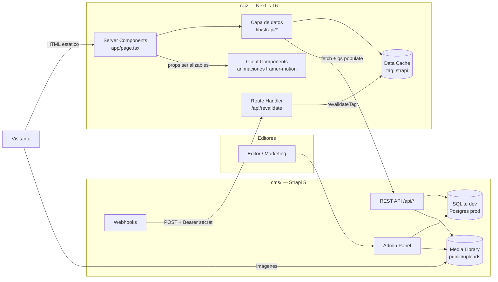

### 3.2 Estructura del repositorio

```text
/                         → Next.js (frontend)
├── app/
│   ├── page.tsx              Server Component: obtiene datos y renderiza bloques
│   └── api/revalidate/       Webhook de Strapi → invalida caché
├── components/
│   ├── block-renderer.tsx    __component de Strapi → componente React
│   └── *-section.tsx         Secciones, ahora reciben props
├── lib/
│   ├── strapi/
│   │   ├── client.ts         fetch, token, caché, errores
│   │   ├── queries.ts        populate por bloque (fragmentos `on`)
│   │   ├── media.ts          URLs de media absolutas (solo servidor)
│   │   ├── fallback.ts       contenido local si no hay CMS
│   │   └── types.ts          contrato de datos
│   └── icons.ts              nombre de ícono (string) → Lucide
├── content/default-content.json   Fuente única: seed + fallback
└── cms/                  → Strapi 5 (backend de contenido)
    ├── config/               server, db, cors, upload, plugins
    ├── src/api/              flavor, global, landing-page
    ├── src/components/       shared, elements, layout, blocks
    ├── src/index.js          bootstrap: permisos públicos de lectura
    └── scripts/seed.js       carga inicial de contenido e imágenes
```

### 3.3 Capas del frontend

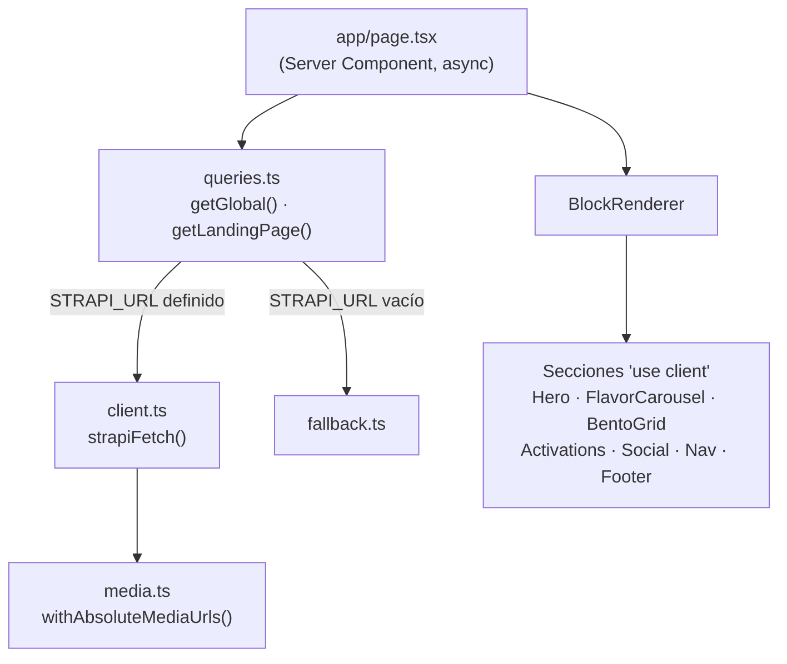

**Regla clave:** solo el servidor habla con Strapi. Los componentes cliente reciben datos planos y URLs ya absolutas, por lo que el navegador nunca necesita variables de entorno del CMS.

---

## 4. Modelo de contenido

### 4.1 Tipos de contenido

| Tipo | Clase | Draft & Publish | Propósito |
|------|-------|-----------------|-----------|
| `landing-page` | Single type | Sí | Home construida con bloques |
| `global` | Single type | No | SEO por defecto, navegación, footer |
| `flavor` | Collection type | Sí | Catálogo de sabores |

### 4.2 Diagrama entidad-relación

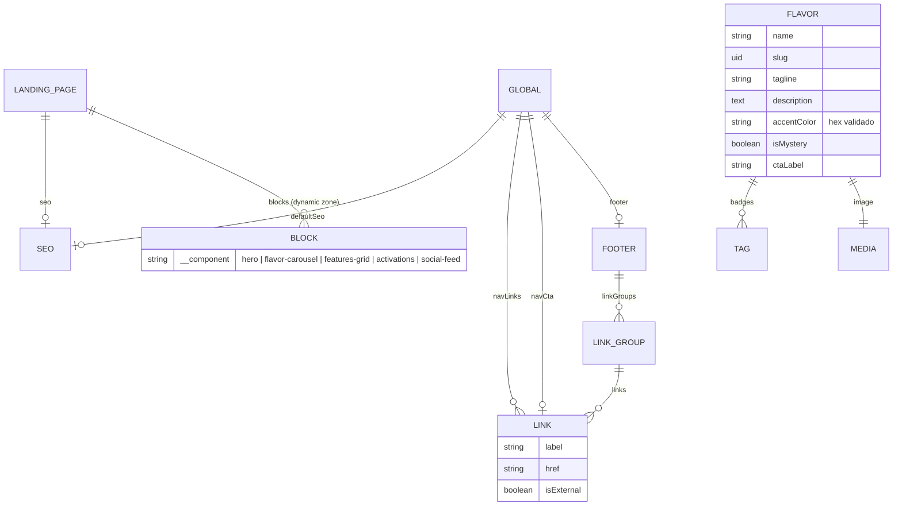

### 4.3 Bloques de la dynamic zone

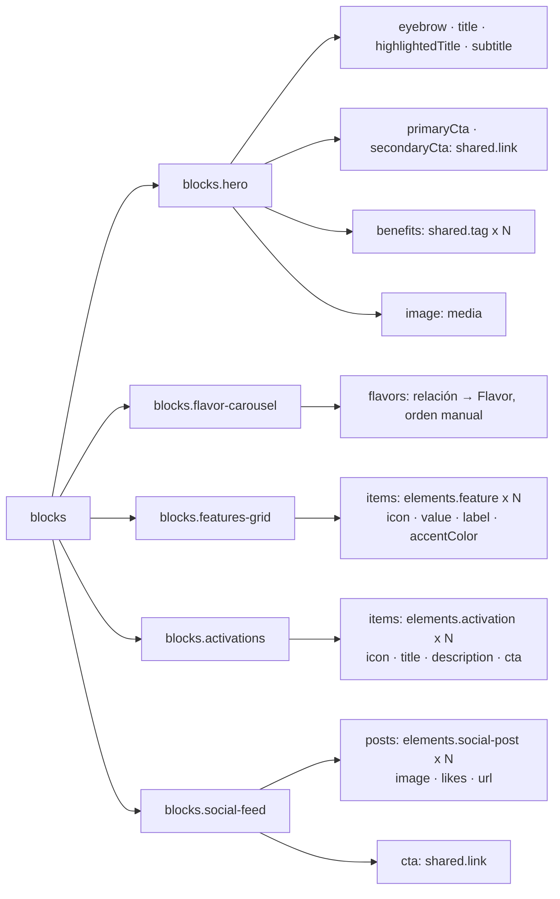

### 4.4 Decisiones de modelado

| Decisión | Motivo |
|----------|--------|
| Título dividido en `title` + `highlightedTitle` | El diseño resalta la segunda línea en verde; evita parsear HTML o markdown. |
| Íconos como `enumeration` | El editor elige de una lista cerrada; el frontend lo mapea a Lucide en `lib/icons.ts`. |
| Colores como `string` con regex `^#[0-9A-Fa-f]{6}$` | Evita valores inválidos sin instalar el plugin color-picker. |
| Listas de textos como componente `shared.tag` repetible | Strapi no tiene arrays de strings; el componente es editable y reordenable. |
| El carrusel referencia sabores por relación | Un sabor se edita en un solo lugar y el carrusel define cuáles y en qué orden. |

---

## 5. Flujos

### 5.1 Flujo editorial (publicar un cambio)

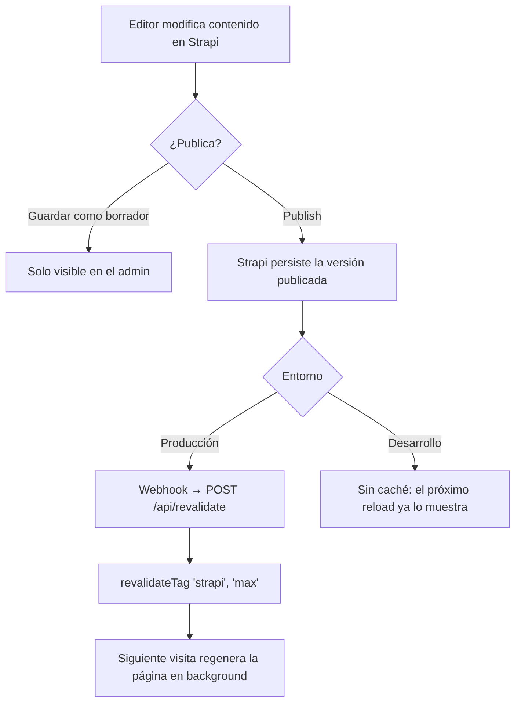

### 5.2 Selección de origen de datos

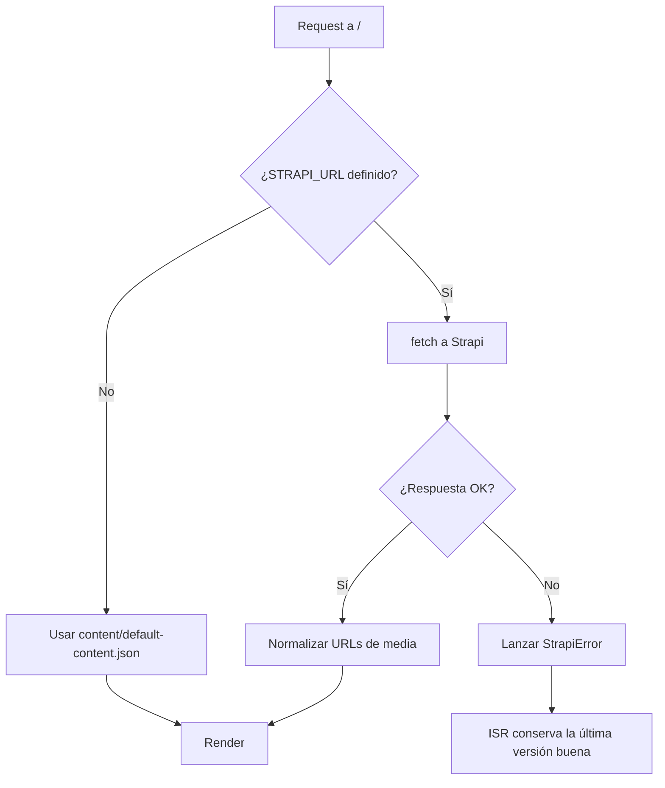

**Por qué no hay fallback silencioso cuando Strapi falla:** si el CMS está configurado pero cae, lanzar el error hace que Next siga sirviendo la última página válida. Un fallback silencioso reemplazaría el contenido real por el contenido inicial.

### 5.3 Render de bloques

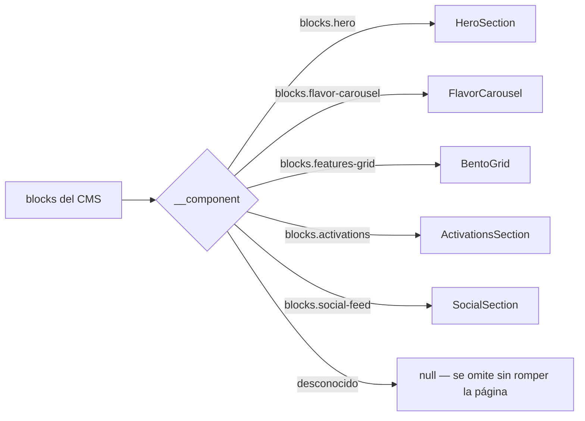

---

## 6. Diagramas de secuencia

### 6.1 Visita a la página (producción, ISR)

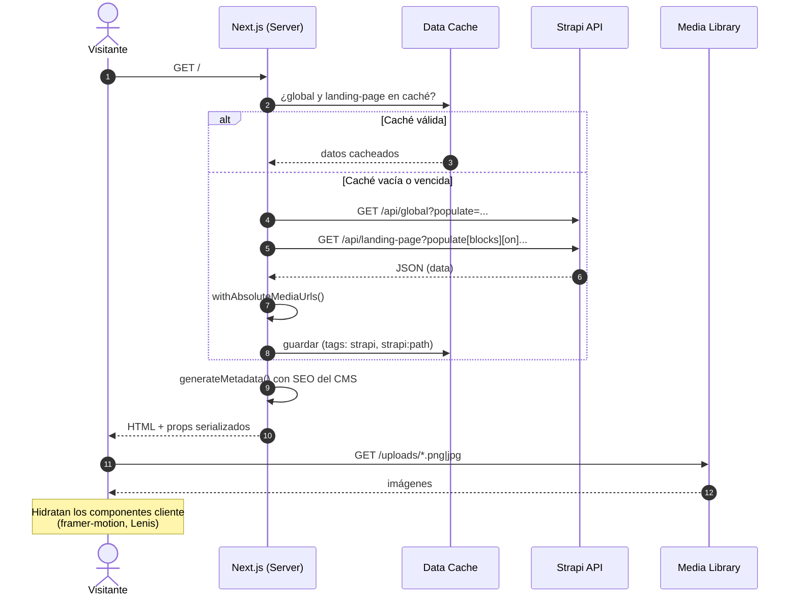

### 6.2 Publicación con revalidación por webhook

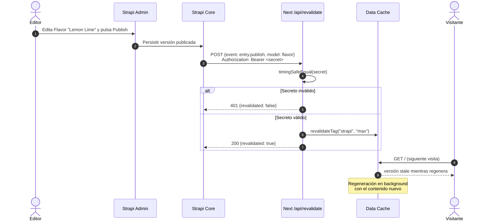

### 6.3 Carga inicial de contenido (seed)

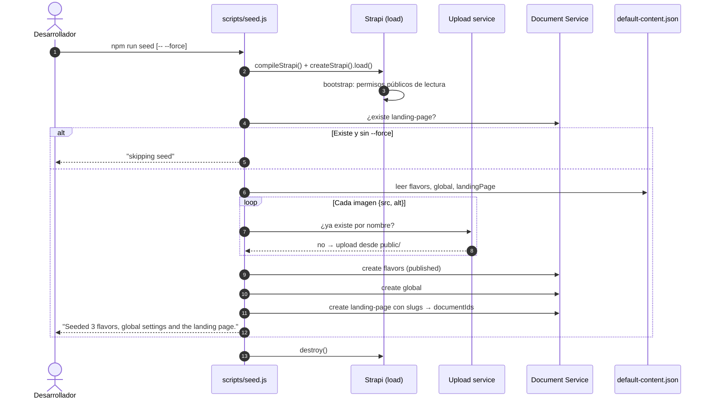

---

## 7. Requisitos

### 7.1 Funcionales

| ID | Requisito | Estado |
|----|-----------|--------|
| RF-01 | Editar todos los textos de cada sección desde Strapi | ✅ |
| RF-02 | Gestionar imágenes desde la Media Library | ✅ |
| RF-03 | CRUD de sabores con color de acento propio | ✅ |
| RF-04 | Reordenar, agregar u ocultar secciones | ✅ Dynamic zone |
| RF-05 | Editar navegación, CTA y footer | ✅ `global` |
| RF-06 | Editar SEO global y por página | ✅ `shared.seo` |
| RF-07 | Ver cambios publicados sin redeploy | ✅ Webhook (prod) / sin caché (dev) |

### 7.2 No funcionales

| ID | Requisito | Implementación |
|----|-----------|----------------|
| RNF-01 | Página estática y rápida | ISR, `revalidate` 3600 s + tag `strapi` |
| RNF-02 | Resiliencia ante caída del CMS | Error explícito → ISR sirve la última versión |
| RNF-03 | Seguridad del webhook | Bearer secret con `timingSafeEqual` |
| RNF-04 | Mínimo privilegio | Rol Public solo con `find`/`findOne`; token opcional |
| RNF-05 | Sin secretos en el cliente | Fetch solo en servidor; sin `NEXT_PUBLIC_*` |
| RNF-06 | Payload liviano | `fields` acotados en media (url, alt, width, height) |
| RNF-07 | Tolerancia a cambios de esquema | Bloques desconocidos se omiten |

---

## 8. Configuración

### 8.1 Variables de entorno

| App | Variable | Uso |
|-----|----------|-----|
| Next | `STRAPI_URL` | URL del CMS. Vacía = fallback local |
| Next | `STRAPI_API_TOKEN` | Token read-only (opcional) |
| Next | `STRAPI_REVALIDATE_SECONDS` | Revalidación por tiempo (default 3600, ignorada en dev) |
| Next | `STRAPI_WEBHOOK_SECRET` | Secreto compartido con el webhook |
| Strapi | `APP_KEYS`, `*_SALT`, `*_SECRET`, `ENCRYPTION_KEY` | Seguridad interna |
| Strapi | `DATABASE_CLIENT`, `DATABASE_URL` | SQLite o Postgres |
| Strapi | `CORS_ORIGINS` | Orígenes permitidos |

### 8.2 Puesta en marcha

```bash
# 1. CMS
cd cms && cp .env.example .env   # completar secretos
npm install
npm run seed                      # contenido inicial
npm run develop                   # http://localhost:1337/admin

# 2. Frontend (en la raíz)
cp .env.example .env.local        # STRAPI_URL=http://localhost:1337
pnpm install
pnpm dev
```

### 8.3 Webhook (producción)

1. Strapi → **Settings → Webhooks → Create new webhook**.
2. URL: `https://<sitio>/api/revalidate`.
3. Header: `Authorization: Bearer <STRAPI_WEBHOOK_SECRET>`.
4. Eventos: `entry.publish`, `entry.unpublish`, `entry.update`, `entry.delete`, `media.*`.

### 8.4 Despliegue sugerido

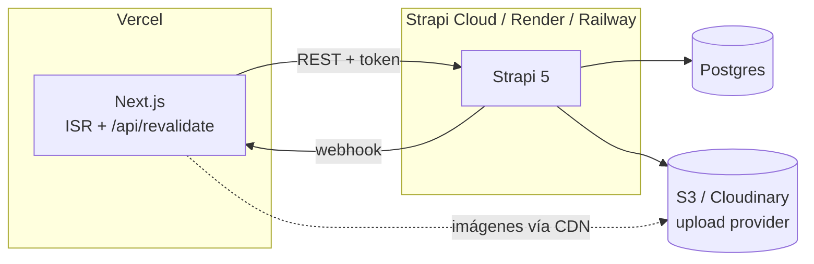

---

## 9. Decisiones técnicas y trade-offs

| Decisión | Alternativa descartada | Motivo |
|----------|------------------------|--------|
| Page builder con dynamic zone | Campos fijos por sección | Editores pueden reordenar y reutilizar bloques |
| REST + `qs` | GraphQL plugin | Menos dependencias; populate explícito alcanza |
| Fetch solo en Server Components | Fetch en el cliente | SEO, sin secretos expuestos, HTML estático |
| ISR + webhook | SSR en cada request | Rendimiento de sitio estático con frescura inmediata |
| JSON único para seed y fallback | Duplicar contenido en TS y JS | Una sola fuente de verdad |
| Monorepo con dos apps independientes | Repos separados | Cambios de esquema y frontend en un mismo PR |
| Colores como estilos inline | Clases Tailwind dinámicas | Tailwind no genera clases para valores en runtime |

---

## 10. Problemas encontrados durante la integración

| Problema | Causa | Solución |
|----------|-------|----------|
| `Error during initial TypeScript compilation: Debug Failure` al iniciar Strapi | El CLI busca `tsconfig.json` hacia arriba y tomaba el de Next | `cms/tsconfig.json` propio con `allowJs` |
| Strapi arrancaba con base vacía | Al compilar a `dist/`, la ruta SQLite apuntaba a `dist/.tmp` | `path.join(__dirname, '..', '..', ...)` en `config/database.js` |
| Cambios publicados no aparecían en dev | Caché de fetch de 1 h y webhook sin configurar | `revalidate: 0` en desarrollo |
| `pnpm add` fallaba con `ERR_PNPM_IGNORED_BUILDS` | pnpm 12 bloquea scripts de `sharp` | `pnpm-workspace.yaml` con `allowBuilds.sharp: false` |
| Gradiente del carrusel sin color | Clases Tailwind con hex del CMS no se generan | `linear-gradient` inline desde `accentColor` |
| Lock de `next dev` | Dos instancias usando `.next/dev` | Detener la instancia duplicada |

---

## 11. Riesgos

| Riesgo | Impacto | Mitigación |
|--------|---------|------------|
| Strapi caído durante `next build` | Build falla | Esperado: evita publicar contenido viejo; reintentar o build sin `STRAPI_URL` |
| Webhook mal configurado | Cambios tardan hasta 1 h | Revalidación por tiempo como red de seguridad |
| Media en disco local de Strapi | Se pierde al redeployar | Usar provider S3/Cloudinary en producción |
| Editor rompe el layout (textos muy largos) | Visual | `maxLength` en SEO; agregar límites en títulos si hace falta |
| Rol Public demasiado amplio | Exposición de datos | Solo lectura; migrar a API token read-only |

---

## 12. Criterios de aceptación

- [x] `GET /api/landing-page` devuelve los 5 bloques con media y relaciones pobladas.
- [x] `GET /api/global` devuelve navegación (5 links) y footer (4 grupos).
- [x] La home renderiza imágenes desde `/uploads` de Strapi.
- [x] Un cambio publicado en un `Flavor` aparece en el sitio (verificado en dev).
- [x] `/api/revalidate` responde 401 sin secreto o con secreto incorrecto.
- [x] `pnpm build` sin `STRAPI_URL` genera `/` estática con el contenido de fallback.
- [x] Paridad visual con el diseño original (Hero y carrusel verificados).

---

## 13. Próximos pasos

1. **Preview de borradores:** Strapi 5 Preview + `draftMode()` de Next.
2. **Producción:** Postgres + upload provider (S3/Cloudinary).
3. **API token read-only** en lugar del rol Public.
4. **i18n** si el sitio será bilingüe (plugin nativo de Strapi).
5. **Newsletter real:** conectar el formulario del footer a un servicio de email.
6. **Sabor Wild Berry:** subir `public/images/drink3-wild-berry.jpg` (ideal: PNG sin fondo) y agregarlo al carrusel.
